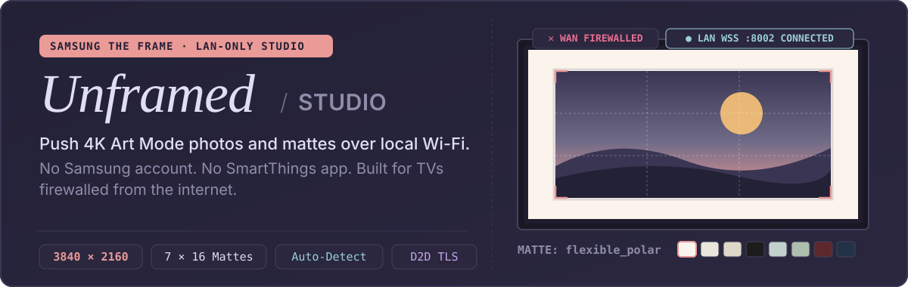
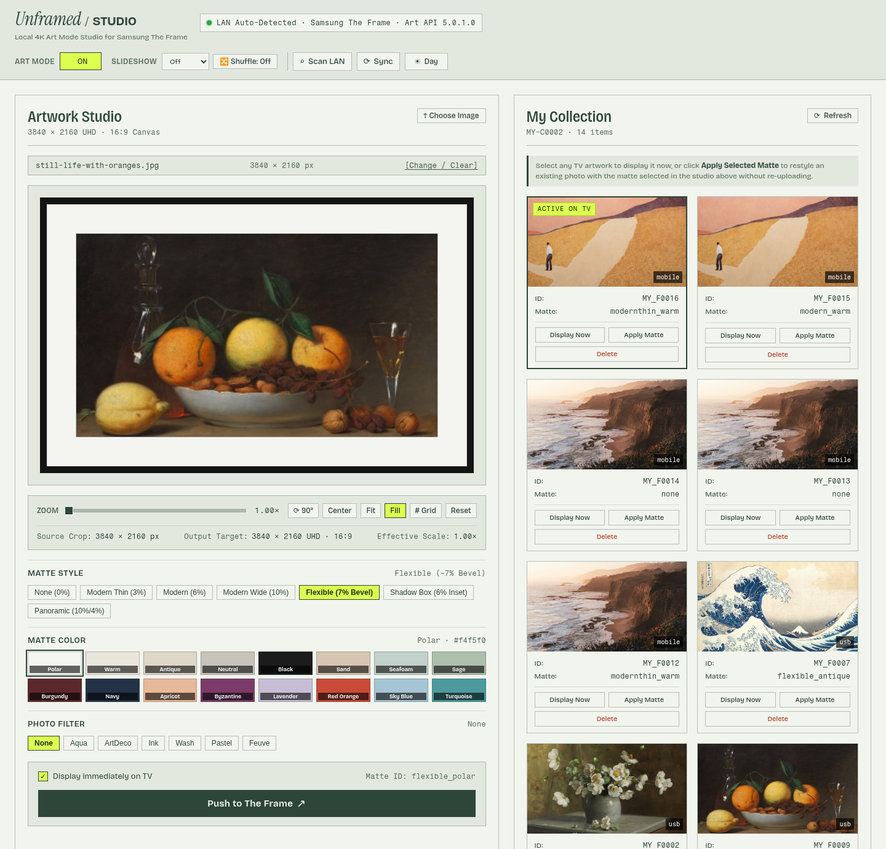
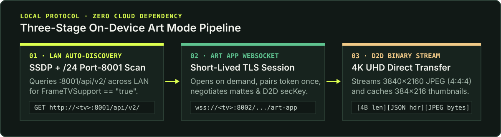

<p align="center">
  
</p>

<p align="center">
  
</p>

**Unframed** is a self-hosted 4K Art Mode studio and gallery for Samsung The Frame TVs. It auto-detects Frame TVs on your local network and pushes `3840 × 2160` UHD artwork, matte styles, and photo filters directly to the TV over LAN — no Samsung account, no SmartThings mobile app, and no internet connection required on the TV.

---

## Why Unframed Exists

Samsung's official workflow for uploading personal photos to The Frame requires signing into a Samsung cloud account, installing the SmartThings app, and allowing the TV to phone home to Samsung telemetry servers. If you firewall your TV from WAN access to block ACR and telemetry, the mobile app stops working.

Unframed speaks the TV's on-device `com.samsung.art-app` TLS WebSocket protocol (`:8002`) and ephemeral Device-to-Device (D2D) binary TLS sockets directly on your local subnet:

- **Zero-config LAN auto-discovery** — finds powered-on Samsung The Frame TVs in ~1.5 seconds via SSDP multicast (`M-SEARCH`) plus an 84-worker `/24` port-8001 capability scan (`FrameTVSupport == "true"`), even from inside a bridge-networked Docker container.
- **Interactive 16:9 4K UHD studio (`3840 × 2160`)** — drag-and-drop JPEG/PNG/WebP, pan, wheel/pinch zoom (`1.0×`–`4.0×`), rotate 90°, toggle a Rule-of-Thirds grid, and encode 95% quality 4:4:4 chroma JPEGs via offscreen canvas + Pillow Lanczos resampling.
- **Realistic matte & filter simulator** — preview all **7 matte styles** (`none`, `modernthin`, `modern`, `modernwide`, `flexible`, `shadowbox`, `panoramic`), all **16 official Samsung matte colors**, and **7 photo filters** with live beveled cutout geometry before pushing to the wall.
- **Live "My Collection" (`MY-C0002`) gallery** — browse stored TV photos with locally cached thumbnails, switch the active display (`Display Now`), restyle mattes on existing photos in place (`Apply Matte`) without re-uploading, or delete items from TV storage.

---

## How It Works

<p align="center">
  
</p>

1. **Discovery (`:1900` SSDP + `:8001/api/v2/`)** — Queries Tizen's local JSON device descriptor to verify `device.FrameTVSupport == "true"`, read the model name, and self-heal if the TV's DHCP lease changes.
2. **Short-lived Art Channel (`wss://<tv-ip>:8002/api/v2/channels/com.samsung.art-app`)** — Opens a TLS WebSocket only when an action runs and closes it immediately afterward, avoiding persistent socket lockups on 2024/2025 Tizen firmware. On first connection, clicking **Allow** on the TV remote issues a pairing token that Unframed saves to `/data/.tv_token`.
3. **Ephemeral D2D TLS Transfer (`:<ephemeral>`)** — For `send_image` and `get_thumbnail_list`, the TV opens a one-shot TLS socket and sends `conn_info` (`ip`, `port`, `key`). Unframed streams `[4-byte big-endian header length][JSON header with secKey][raw JPEG bytes]` directly to the TV and caches a `384 × 216` gallery thumbnail locally.

---

## Quickstart

### Docker Compose (Zero Configuration Required)

```bash
git clone https://github.com/aaclarker/unframed.git
cd unframed
docker compose up -d --build
```

Open **`http://localhost:8094`**:

1. **Auto-Detection**: With your Frame TV powered on (or in Art Mode), Unframed automatically discovers it on your LAN and persists its IP and model in `/data/.tv_state.json`.
2. **First-Time Pairing**: Approve the *"Allow Unframed to connect?"* prompt on your TV using the remote once. Unframed persists the token automatically.
3. **Multi-TV or Routed VLANs**: Click **⌕ Scan LAN** in the header at any time to rescan, or copy `.env.example` to `.env` to pin `FRAME_TV_IP`, `FRAME_TV_SUBNET`, or an existing Home Assistant `samsungtv` token.

### Local Python (`uv`)

Requires Python 3.12+ and [`uv`](https://docs.astral.sh/uv/):

```bash
cd app
uv run --with-requirements pyproject.toml uvicorn main:app --host 127.0.0.1 --port 8094
```

---

## Configuration & Reference

All environment variables are optional and can be set in `.env` (see [`.env.example`](.env.example)):

| Variable | Default | Description |
|---|---|---|
| `FRAME_TV_IP` | *(auto-detected)* | Static LAN IP of your Samsung The Frame TV |
| `FRAME_TV_SUBNET` | *(auto-detected)* | `/24` subnet hint for LAN auto-discovery (e.g. `192.168.1.0/24`) |
| `FRAME_TV_PORT` | `8002` | TLS WebSocket port on the TV |
| `FRAME_TV_WS_NAME` | `Unframed` | Client name (plain text or base64-encoded) sent during WebSocket handshake |
| `FRAME_TV_TOKEN` | *(auto-saved)* | 8-digit pairing token; persisted automatically per TV on first approval |
| `FRAME_TV_MODEL` | *(auto-discovered)* | Override for the TV model badge (otherwise read from `http://<ip>:8001/api/v2/`) |
| `PORT` | `8094` | Host port mapped by `docker-compose.yml` |

<details>
<summary><strong>REST API Endpoints</strong></summary>

- `GET /healthz` — Healthcheck (`{"ok": true}`).
- `GET /api/status` — Live TV status, active artwork, `my_photos` (`MY-C0002`), `discovered_tvs`, and supported mattes/filters.
- `GET /api/discover` / `POST /api/discover` — Scans the LAN and returns all discovered Samsung The Frame TVs.
- `POST /api/tv/select` — Switches the active TV (`{"ip": "192.168.1.x"}`).
- `GET /api/thumbnail/{content_id}` — Returns the cached or D2D-fetched JPEG thumbnail (`image/jpeg`).
- `POST /api/upload` — Multipart upload (`file`, `matte_id`, `portrait_matte_id`, `photo_filter`, `show_now`, optional `crop_x`, `crop_y`, `crop_w`, `crop_h`, `rotate`).
- `POST /api/select` — Displays an existing artwork immediately on the TV (`{"content_id": "MY_F0001", "show": true}`).
- `POST /api/matte` — Restyles an existing artwork's matte and photo filter in place (`{"content_id": "MY_F0001", "matte_id": "flexible_polar", "photo_filter": "None"}`).
- `DELETE /api/art/{content_id}` — Deletes an artwork from TV storage and purges its cached thumbnail.
- `POST /api/artmode` — Toggles Art Mode on or off (`{"status": "on" | "off"}`).
- `POST /api/slideshow` — Sets slideshow interval in minutes (`0` = off) and shuffle (`{"duration": 15, "shuffle": true}`).

</details>

<details>
<summary><strong>Tizen Art API 5.0.1.0 Quirks & Compatibility Notes</strong></summary>

- **Command names**: 2024/2025 Frame firmware (`Art API 5.0.1.0`, e.g. `LS03D` / `LS03F`) uses `"request": "api_version"` rather than `"get_api_version"` (which is silently ignored).
- **Stringified `conn_info`**: In `get_thumbnail_list` and `send_image` (`ready_to_use`), `conn_info` is returned as a JSON-encoded string inside the D2D service message payload, and `conn_info["id"]` must match the outer `request_id` UUID.
- **OpenSSL 3 EOF handling**: Tizen's ephemeral D2D TLS socket server closes the TCP stream immediately after sending thumbnail bytes without a TLS `close_notify` alert; Unframed sets `ssl.OP_IGNORE_UNEXPECTED_EOF` so Python 3.12+ / OpenSSL 3 reads complete cleanly.
- **Firewalling tip**: Block your TV's LAN IP on `LAN_IN` → WAN (drop outbound internet routing) rather than using your router's L2 client block, so the TV keeps DHCP and local subnet access while having zero WAN connectivity.

</details>

---

## License

[MIT](LICENSE)
